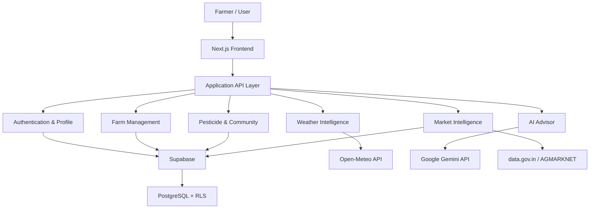

# 🌾 AgroCast AI

<h3 align="center">AI-Powered Agricultural Intelligence Platform</h3>

<p align="center">
  <strong>Empowering Andhra Pradesh Farmers Through AI, Weather Intelligence & Agricultural Data.</strong>
</p>

<p align="center">
  <a href="https://agrocast-ai.vercel.app/">
    
  </a>
  <a href="https://github.com/Kalam-Venu/Agrocast-AI">
    
  </a>
</p>

<p align="center">
  
  
  
  
  
  
  
</p>

---

## 📖 Table of Contents

- [Overview](#-overview)
- [Problem Statement](#-problem-statement)
- [Our Solution](#-our-solution)
- [Key Features](#-key-features)
- [Application Architecture](#-application-architecture)
- [Technology Stack](#-technology-stack)
- [Database Design](#-database-design)
- [API Reference](#-api-reference)
- [Project Structure](#-project-structure)
- [Getting Started](#-getting-started)
- [Environment Configuration](#-environment-configuration)
- [Database Setup](#-database-setup)
- [Deployment](#-deployment)
- [Data Sources & Transparency](#-data-sources--transparency)
- [Future Roadmap](#-future-roadmap)
- [Contributing](#-contributing)
- [License](#-license)

---

## 🌱 Overview

**AgroCast AI** is a Telugu-first, bilingual agricultural intelligence and farmer assistance platform designed for the farming community of Andhra Pradesh, India.

It combines AI-powered agricultural guidance, localized weather intelligence, pesticide information, farmer community experiences, and agricultural market data into a unified platform.

The application is designed to make relevant agricultural information more accessible, understandable, and useful to farmers through a simple interface supporting Telugu and English.

<p align="center">
  <strong>One Platform. Multiple Agricultural Intelligence Services.</strong>
</p>

## 🎯 Problem Statement

Farmers frequently depend on multiple disconnected sources for essential agricultural information.

Some of the major challenges include:

- Limited access to localized and understandable agricultural information.
- Difficulty interpreting changing weather conditions.
- Lack of personalized crop-related guidance.
- Difficulty identifying reliable pesticide information.
- Limited visibility into agricultural market prices.
- Language barriers when accessing digital agricultural services.

## 💡 Our Solution

AgroCast AI addresses these challenges through an integrated agricultural platform featuring:

- AI-powered conversational farming assistance.
- Location-aware weather intelligence.
- Personalized farm and crop management.
- Pesticide information and image analysis.
- Farmer reviews and community interaction.
- Agricultural market-price discovery.
- Telugu-first bilingual accessibility.

---

## 🚀 Key Features

<table>
<tr>
<td width="50%">

### 🌦️ Weather Intelligence

- Current weather conditions.
- Hourly and seven-day forecasts.
- Rainfall and temperature information.
- Agricultural risk indicators.
- Weather-related farming insights.

</td>
<td width="50%">

### 🌱 My Farm

- Personalized farm profiles.
- District, mandal, and village selection.
- Multiple crop management.
- Soil and irrigation details.
- Crop growth-stage tracking.
- Cloud-based farm persistence.

</td>
</tr>
<tr>
<td width="50%">

### 🤖 AI Farming Advisor

- Gemini-powered conversations.
- Telugu, English, and Tanglish support.
- Farm-aware agricultural guidance.
- Weather-context integration.
- Image-based agricultural analysis.
- Contextual follow-up questions.

</td>
<td width="50%">

### 🧪 Pesticide Intelligence

- Pesticide information and search.
- Crop and pest-related information.
- Crop image analysis.
- Pesticide-label image analysis.
- Farmer reviews and comments.
- Community feedback and reporting.

</td>
</tr>
<tr>
<td width="50%">

### 📈 Market Intelligence

- AGMARKNET market-price integration.
- Commodity and market filters.
- District-based market discovery.
- MSP information.
- Market-price comparison.
- Net-return estimation.

</td>
<td width="50%">

### 🌐 Bilingual Experience

- Telugu-first interface.
- English language support.
- Persistent language preferences.
- Localized application content.
- Language-aware AI responses.

</td>
</tr>
</table>

---

## 🏗️ Application Architecture

AgroCast AI follows a modular full-stack architecture built around Next.js API Route Handlers, external integrations, and Supabase.



### Architecture Layers

| Layer | Responsibility |
|---|---|
| Presentation | Responsive React interface and bilingual experience |
| Application | Next.js pages, components, and application state |
| API | Server-side route handlers and request validation |
| Services | Authentication, farm, AI, weather, and market operations |
| Database | Supabase PostgreSQL and Row Level Security |
| Integrations | Gemini, Open-Meteo, and AGMARKNET |

---

## 💻 Technology Stack

| Technology | Purpose |
|---|---|
| Next.js | Full-stack application framework |
| React | Component-based UI |
| JavaScript (JSX) | Application development |
| Tailwind CSS | Responsive styling |
| Supabase | Backend platform and PostgreSQL |
| Supabase Auth | User authentication |
| PostgreSQL | Persistent relational database |
| Gemini API | AI-powered agricultural assistance |
| Open-Meteo | Weather information |
| data.gov.in | Agricultural market-price data |
| Vercel | Application deployment |
| Git & GitHub | Version control |

---

## 🗄️ Database Design

AgroCast AI uses Supabase PostgreSQL for persistent user and application data.

### Core Database Entities

| Table | Description |
|---|---|
| `profiles` | Farmer profiles and account information |
| `farm_profiles` | Farm details and location information |
| `farm_crops` | Crops associated with farmer profiles |
| `custom_settlements` | User-created settlement records |
| `user_preferences` | User preferences and settings |
| `conversations` | AI Advisor conversations |
| `conversation_messages` | Conversation messages |
| `pesticides` | Pesticide reference information |
| `pesticide_reviews` | Farmer-submitted reviews |
| `review_comments` | Community comments |
| `review_votes` | Review helpfulness votes |
| `content_reports` | Reported community content |
| `markets` | Agricultural market information |
| `market_prices` | Market-price records |
| `msp_rates` | Minimum Support Price information |
| `notifications` | User notifications |

### Security

- Supabase authentication.
- Server-side authenticated database operations.
- Row Level Security (RLS).
- Owner-scoped access to private farm records.
- Server-side storage of external API credentials.
- No service-role key exposed to the browser.

---

## 🔌 API Reference

All application endpoints are implemented using Next.js Route Handlers.

### Health & Profile

| Method | Endpoint | Description |
|---|---|---|
| GET | `/api/health` | Integration configuration status |
| GET | `/api/profile` | Retrieve farmer profile |
| PUT | `/api/profile` | Update farmer profile |
| PUT | `/api/profile/language` | Update language preference |

### Locations

| Method | Endpoint | Description |
|---|---|---|
| GET | `/api/locations` | Location information |
| GET | `/api/locations/districts` | District listing |
| GET | `/api/locations/mandals` | Mandal listing |
| GET | `/api/locations/villages` | Available village listing |

### Farm Management

| Method | Endpoint | Description |
|---|---|---|
| GET | `/api/farm` | Retrieve farm information |
| POST | `/api/farm` | Create farm snapshot |
| PUT | `/api/farm` | Update farm snapshot |
| GET | `/api/farm/crops` | Retrieve farm crops |
| POST | `/api/farm/crops` | Add a crop |
| PUT | `/api/farm/crops/:id` | Update a crop |
| DELETE | `/api/farm/crops/:id` | Remove a crop |

### Weather & AI

| Method | Endpoint | Description |
|---|---|---|
| GET | `/api/weather/current` | Current weather |
| GET | `/api/weather/forecast` | Weather forecast |
| GET | `/api/weather/alerts` | Weather alerts and risk indicators |
| GET | `/api/weather/history` | Seasonal rainfall information |
| POST | `/api/advisor/chat` | AI Advisor conversation |
| GET | `/api/advisor/conversations` | Retrieve conversations |
| POST | `/api/advisor/conversations` | Create conversation |
| GET | `/api/advisor/conversations/:id` | Retrieve conversation |
| DELETE | `/api/advisor/conversations/:id` | Delete conversation |
| POST | `/api/advisor/analyze-image` | Image-based agricultural analysis |

### Pesticides & Community

| Method | Endpoint | Description |
|---|---|---|
| GET | `/api/pesticides` | List pesticide information |
| GET | `/api/pesticides/:id` | Retrieve pesticide details |
| GET | `/api/pesticides/search` | Search pesticide information |
| GET | `/api/reviews` | Retrieve farmer reviews |
| POST | `/api/reviews` | Submit a review |
| GET | `/api/reviews/:id` | Retrieve review details |
| POST | `/api/reviews/:id/comments` | Add a comment |
| POST | `/api/reviews/:id/vote` | Vote on a review |
| POST | `/api/reviews/:id/report` | Report content |

### Market Intelligence

| Method | Endpoint | Description |
|---|---|---|
| GET | `/api/markets` | Retrieve markets |
| GET | `/api/markets/nearby` | Find nearby markets |
| GET | `/api/markets/:id` | Retrieve market details |
| GET | `/api/market-prices` | Retrieve AGMARKNET prices |
| GET | `/api/market-prices/trends` | Retrieve market trend data |
| GET | `/api/msp` | Retrieve MSP information |
| POST | `/api/markets/estimate` | Estimate market returns |

*The API list describes the documented application routes. Actual request parameters and response schemas should be consulted in the corresponding source files.*

---

## 📂 Project Structure

```text
Agrocast-AI/
│
├── app/
│   ├── api/
│   │   ├── advisor/
│   │   ├── farm/
│   │   ├── health/
│   │   ├── locations/
│   │   ├── markets/
│   │   ├── market-prices/
│   │   ├── pesticides/
│   │   ├── profile/
│   │   ├── reviews/
│   │   └── weather/
│   │
│   ├── advisor/
│   ├── community/
│   ├── farm/
│   ├── markets/
│   ├── pesticides/
│   ├── weather/
│   └── ...
│
├── components/
│
├── contexts/
│
├── lib/
│   ├── services/
│   ├── supabase/
│   └── ...
│
├── public/
│
├── supabase/
│   ├── migrations/
│   │   ├── 001_initial_schema.sql
│   │   ├── 002_auth_user_data_and_rls.sql
│   │   └── 003_farm_and_review_rpc.sql
│   │
│   └── recovery/
│
├── .env.example
├── .gitignore
├── next.config.mjs
├── package.json
├── README.md
└── ...
```

*This is a high-level overview; individual filenames and folders may vary with the current implementation.*

---

## ⚙️ Getting Started

### Prerequisites

Make sure you have:

- Node.js (LTS recommended).
- npm.
- Git.
- A Supabase project.
- A Google Gemini API key.
- A data.gov.in API key.

### 1. Clone the Repository

```bash
git clone https://github.com/Kalam-Venu/Agrocast-AI.git

cd Agrocast-AI
```

### 2. Install Dependencies

```bash
npm install
```

### 3. Configure Environment Variables

Create a `.env.local` file in the root directory.

```env
NEXT_PUBLIC_SUPABASE_URL=https://YOUR_PROJECT.supabase.co
NEXT_PUBLIC_SUPABASE_ANON_KEY=YOUR_SUPABASE_PUBLISHABLE_KEY

GEMINI_API_KEY=YOUR_GEMINI_API_KEY

DATA_GOV_IN_API_KEY=YOUR_DATA_GOV_IN_API_KEY

WEATHER_API_BASE_URL=https://api.open-meteo.com/v1

NEXT_PUBLIC_APP_URL=http://localhost:3000
```

Replace all placeholder values with your actual credentials.

> **Security:** Never commit `.env.local` or expose private API credentials in client-side code. Keep server-side credentials out of `NEXT_PUBLIC_` variables.

### 4. Configure Supabase

Run the SQL migrations in the following order:

```text
001_initial_schema.sql
002_auth_user_data_and_rls.sql
003_farm_and_review_rpc.sql
```

For an existing partially initialized database, use the documented recovery procedure rather than blindly rerunning the baseline migration.

Configure the Supabase authentication Site URL and redirect URLs for your application.

### 5. Run the Development Server

```bash
npm run dev
```

Open the application:

```text
http://localhost:3000
```

### 6. Build for Production

```bash
npm run build
```

### 7. Run the Production Build Locally

```bash
npm start
```

---

## ☁️ Deployment

AgroCast AI is deployed on Vercel.

<p align="center">
  <a href="https://agrocast-ai.vercel.app/">
    
  </a>
</p>

### Deployment Checklist

1. Push the latest code to GitHub.
2. Import the repository into Vercel.
3. Configure the required environment variables.
4. Deploy the Next.js application.
5. Configure Supabase authentication URLs.
6. Test user registration and login.
7. Verify farm persistence and AI Advisor functionality.
8. Test external data integrations.

---

## 📊 Data Sources & Transparency

AgroCast AI uses external APIs and locally maintained reference datasets.

| Source | Purpose |
|---|---|
| Open-Meteo | Weather forecasts and conditions |
| Google Gemini | AI-powered agricultural conversations and image analysis |
| data.gov.in / AGMARKNET | Agricultural market-price information |
| Supabase | Authentication and persistent application data |
| Local reference datasets | Regional location and agricultural information |

### Current Dataset Coverage

The checked-in Andhra Pradesh location dataset currently contains:

| Dataset | Available Entries |
|---|---:|
| Districts | 26 |
| Mandals | 644 |
| Village entries | 1,047 |

This is a working dataset, not a complete authoritative village directory. User-created settlements may use approximate parent-mandal coordinates.

### Known Limitations

- Market-price availability depends on the external data.gov.in service.
- Market trend visualizations currently include sample data rather than a complete live historical feed.
- Some market-yard coordinates require further verification.
- Application-generated weather risks are not official IMD warnings.
- Pesticide information must be checked against authoritative registration and label sources before application.
- AI-generated guidance is informational and does not replace advice from agricultural officers or KVK specialists.
- Some legacy application features still use local or in-memory data.

---

## 🛣️ Future Roadmap

- [ ] Expand verified village-level location coverage.
- [ ] Improve market-yard geospatial accuracy.
- [ ] Integrate historical market-price analytics.
- [ ] Expand official agricultural data integrations.
- [ ] Improve regional crop and soil intelligence.
- [ ] Strengthen automated integration and security testing.
- [ ] Conduct broader validation with farmers and agricultural experts.

---

## 🤝 Contributing

Contributions and suggestions are welcome.

1. Fork the repository.
2. Create a feature branch.
3. Implement your changes.
4. Test your changes.
5. Submit a pull request with a clear description.

---

## 📄 License

A license has not yet been specified. Please contact the repository owner regarding usage and distribution permissions.

---

## 👨‍💻 Project Information

| Detail | Information |
|---|---|
| Project | AgroCast AI |
| Category | AgriTech / Artificial Intelligence |
| Target Region | Andhra Pradesh, India |
| Primary Languages | Telugu and English |
| Frontend | Next.js and React |
| Backend | Next.js API Route Handlers |
| Database | Supabase PostgreSQL |
| AI Integration | Google Gemini |
| Deployment | Vercel |

<p align="center">
  <a href="https://agrocast-ai.vercel.app/">Live Application</a> ·
  <a href="https://github.com/Kalam-Venu/Agrocast-AI">GitHub Repository</a>
</p>

<p align="center">
  <strong>🌾 AgroCast AI</strong>
  <br/>
  <em>Bringing Agricultural Intelligence Closer to Every Farmer.</em>
</p>