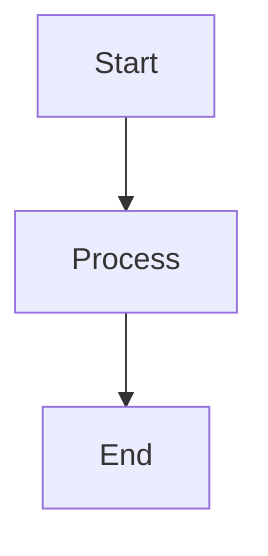

# AgroCast AI — Complete Project Specification

## 1. Project Overview

### Project Name

**AgroCast AI — AI-Powered Agricultural Intelligence Platform**

### Project Description

Build a full-stack, AI-powered agricultural intelligence and farmer assistance platform designed specifically for farmers in Andhra Pradesh, India.

AgroCast AI aims to help farmers make better agricultural decisions through weather intelligence, personalized AI farming guidance, pesticide information, farmer experiences, and agricultural market intelligence.

The platform must bring multiple agricultural services together in one simple, accessible interface.

The application must prioritize Telugu-speaking farmers. Telugu must be the default application language, with an option to switch to English at any time. The selected language must be maintained throughout the entire application, including the AI Farming Advisor.

The application should be mobile-first, responsive, easy to understand, and usable by farmers with limited technical experience.

### Primary Objectives

- Provide location-based weather information and early warnings.
- Help farmers make informed decisions about crops, soil, sowing, irrigation, and crop management.
- Provide reliable pesticide information and a platform for sharing farmer experiences.
- Help farmers understand crop prices, government MSP information, and nearby agricultural markets.
- Provide AI-powered agricultural assistance using the farmer's farm profile and relevant weather information.
- Make agricultural information accessible in both Telugu and English.
- Use free APIs, open datasets, and free service tiers wherever possible.
- Build a working software-only MVP without requiring additional hardware.

### Target Users

- Farmers in Andhra Pradesh.
- Small and medium-scale farmers.
- Farmers looking for weather-based agricultural guidance.
- Farmers seeking pesticide information and practical experiences.
- Farmers comparing agricultural market prices and selling opportunities.

### Geographic Scope

The initial version must focus exclusively on Andhra Pradesh.

The application must support the following location hierarchy:

**State → District → Mandal → Village**

Andhra Pradesh should be preselected as the state.

The application must not assume that a farmer's current GPS location is necessarily the location of their agricultural land. Farmers must be able to select and save their actual farm location manually.

---

## 2. Technology Stack

Use a modern, maintainable, full-stack architecture.

### Frontend

- Next.js with App Router.
- React.
- TypeScript.
- Tailwind CSS.
- Lucide React for icons.
- Recharts for charts and agricultural price visualization.
- React Context or an equivalent lightweight state-management approach for global application state.
- A centralized internationalization/localization system for Telugu and English.

### Backend

- Next.js Route Handlers for backend API endpoints.
- TypeScript.
- Server-side validation.
- Secure API communication.
- Modular service architecture.

Avoid introducing a separate Express backend unless there is a demonstrated technical requirement.

### Database and Authentication

- Supabase PostgreSQL for persistent application data.
- Supabase Auth for registration, login, and session management.
- Supabase Row Level Security (RLS) for protecting user-specific records.
- Supabase Storage for supported image and video uploads, subject to available free-tier limits.

### AI Integration

- Google Gemini API or another available AI provider with a usable free tier.
- Server-side AI requests only.
- Structured prompts using the farmer's saved profile, selected language, location, crop information, and weather context.
- Multimodal model support for crop-image analysis where available.

The application must not expose AI provider API keys in frontend code.

If an AI provider is unavailable or its quota is exceeded, display a clear error and offer retry or non-AI help where appropriate. Do not invent agricultural guidance as an offline fallback or pretend that an AI response was generated when it was not. Simple greetings may be handled locally.

### Weather Integration

- Open-Meteo Weather API for weather conditions and forecasts.
- Open-Meteo historical data where available.
- Official government weather warnings and alerts where accessible.

Open-Meteo forecasts must not be represented as official government alerts.

### Maps and Location

- Browser Geolocation API with explicit user permission.
- OpenStreetMap-based mapping where needed.
- Manual Andhra Pradesh district, mandal, and village selection.

### Agricultural Data Sources

Prioritize trustworthy sources, including:

- India Meteorological Department (IMD).
- Andhra Pradesh Department of Agriculture.
- ANGRAU.
- ICAR.
- Krishi Vigyan Kendras (KVKs).
- CIBRC.
- AGMARKNET.
- e-NAM.
- Government MSP announcements and procurement information.

Use public datasets or APIs only when their availability, terms, and data quality are suitable.

### Deployment and Version Control

- GitHub for source-code management.
- Vercel for frontend deployment.
- Supabase for backend services and database.

### Cost Constraints

The MVP must be designed around free services and free tiers.

- Do not require paid APIs for core functionality.
- Do not require hardware or IoT devices.
- Avoid unnecessary paid libraries and services.
- Document service quotas and limitations.
- Keep credentials in environment variables.
- Include a `.env.example` file.
- Clearly distinguish real API data, verified static data, and demonstration data.

---

## 3. Core Features

The platform consists of four primary modules.

### 3.1 Weather Intelligence & Early Warning System

The Weather Intelligence module must provide location-based weather information to help farmers make timely agricultural decisions.

#### Location Detection

- Request browser location permission when the farmer chooses automatic location detection.
- Use GPS coordinates to obtain the approximate current location when permission is granted.
- Allow manual location selection using Andhra Pradesh district, mandal, and village.
- Allow farmers to save their farm location for future visits.
- Allow farmers to edit their saved location.
- Never force GPS access; manual selection must always remain available.
- Clearly distinguish current device location from saved farm location.

#### Weather Dashboard

Display:

- Current temperature.
- Feels-like temperature when available.
- Weather condition.
- Humidity.
- Wind speed and direction when available.
- Rainfall information.
- Probability of precipitation when available.
- Sunrise and sunset when available.

#### Weather Forecast

Provide:

- Current weather conditions.
- Detailed hourly forecast for today and tomorrow when supported by the source.
- Daily forecast for the next seven days.
- Extended outlook up to fourteen days where supported.

Extended forecasts must be clearly identified as less certain than near-term forecasts. Do not invent forecast data when the source does not provide it.

#### Weather Alerts

The application must identify and display relevant severe weather warnings when reliable information is available.

Alert categories include:

- Heavy rainfall.
- Cyclone.
- Strong winds.
- Heatwave.
- Cold wave.
- Drought-related risk.
- Other severe weather conditions supported by the available data.

For every alert, display:

- Alert category.
- Affected location.
- Description.
- Severity where supported.
- Validity period when available.
- Source.
- Last updated time.

Distinguish official government warnings from application-generated weather risk notifications.

Never label an application-generated risk assessment as an official government warning.

#### Rainfall Intelligence

Where reliable historical and normal rainfall data is available:

- Display recent rainfall information.
- Compare rainfall against the relevant normal period.
- Identify rainfall deficit or surplus.
- Present useful summaries for agricultural planning.

If the required historical or normal data is unavailable, clearly communicate that limitation.

#### Notifications

- Display important alerts inside the application.
- Allow farmers to view previous alerts.
- Provide browser notifications where supported and permission is granted.
- SMS and WhatsApp notifications are future enhancements, not MVP requirements.

---

### 3.2 My Farm & AI Farming Advisor

This module must provide personalized agricultural guidance based on the farmer's location, soil, crops, and farming information.

#### Farm Setup

The farmer should be guided through a simple farm setup process.

Location selection:

1. State: Andhra Pradesh, preselected.
2. District.
3. Mandal.
4. Village.

#### Soil Information

Display relevant regional soil information for the selected area.

Possible soil categories include:

- Red soil.
- Black soil.
- Alluvial soil.
- Sandy soil.
- Other locally relevant categories.

Important requirements:

- Regional soil information must not be represented as laboratory-verified information about an individual field.
- Allow the farmer to confirm their actual soil type.
- Include a "Not sure" option.
- Provide simple descriptions of soil characteristics.
- Allow farmers to update their selection.

#### Crop Selection

- Display crops commonly cultivated in the selected area using available agricultural data.
- Support multiple crop selections.
- Allow the farmer to search for other crops.
- Allow the farmer to confirm the crops actually being cultivated.
- Do not assume that regional crop recommendations represent the farmer's current crop.

#### Additional Farm Information

Allow the farmer to optionally provide:

- Land area.
- Soil type.
- Irrigation method.
- Selected crops.
- Sowing date.
- Current crop growth stage.
- Other relevant farming details.

Save the farm profile and allow it to be edited later.

#### AI Farming Advisor

The AI Farming Advisor is a central feature of AgroCast AI.

It must provide a conversational interface where farmers can ask agricultural questions in natural language.

Supported topics include:

- Crop selection.
- Suitable sowing periods.
- Land preparation.
- Seed selection.
- Crop growth stages.
- Irrigation guidance.
- Fertilizer and nutrient management.
- Weed management.
- Pest and disease management.
- Harvesting guidance.
- Weather-related farming decisions.

The AI should use the farmer's saved farm profile and relevant weather information to provide contextual guidance.

Farmers should not need to repeatedly provide information already saved in their farm profile.

#### Personalized Responses

The AI should consider:

- District, mandal, and village.
- Crop selection.
- Soil type.
- Sowing date.
- Crop growth stage.
- Irrigation method.
- Current and forecast weather.
- Relevant verified agricultural information.

When important information is missing, the AI should ask useful follow-up questions rather than make unsupported assumptions.

#### Crop Image Analysis

Where the AI provider supports image input:

- Allow farmers to upload crop images.
- Analyze visible symptoms.
- Identify possible disease, pest, nutrient deficiency, or water stress.
- Ask additional questions when the image alone is insufficient.
- Explain the likely causes and recommended next steps.
- Clearly communicate uncertainty.
- Recommend consultation with qualified agricultural experts for severe or uncertain cases.

The application must not claim that image-based diagnosis is always accurate.

#### AI Safety Requirements

- Never guarantee crop yield or profit.
- Never invent pesticide approvals or dosage instructions.
- Never provide unsupported treatment recommendations.
- Prefer verified agricultural information.
- Communicate uncertainty clearly.
- Distinguish general guidance from official agricultural recommendations.
- Encourage expert consultation for serious crop problems.

#### Conversation History

- Save conversations for authenticated users.
- Display previous conversations.
- Allow users to continue an existing conversation.
- Maintain the relevant farm context.
- Maintain the selected response language.

#### Crop Progress Tracker

Provide a basic crop tracking interface where farmers can:

- View their selected crops.
- Record sowing dates.
- Update crop growth stages.
- Add progress notes.
- View important farming activities.

---

### 3.3 Pesticide Intelligence & Farmer Community

This module must help farmers understand pesticide products and learn from the experiences of other farmers.

It must combine verified agricultural information with farmer-submitted experiences.

#### Pesticide Search

Allow farmers to search and filter by:

- Pesticide name.
- Brand name.
- Active ingredient.
- Crop.
- Target pest.
- Target disease.
- Product category.

#### Pesticide Information

Each pesticide detail page should display available verified information:

- Product name.
- Brand name.
- Active ingredient.
- Formulation.
- Pesticide category.
- Approved crop uses.
- Target pests or diseases.
- Registered dosage and application method, only when verified.
- Safety precautions.
- Personal protective equipment information.
- Pre-harvest interval, when available.
- Re-entry information, when available.
- Official information source.
- Last verification date.

#### Information Sources

Prioritize:

- CIBRC.
- ICAR.
- ANGRAU.
- Andhra Pradesh Department of Agriculture.
- KVKs.
- Other trustworthy agricultural research and regulatory sources.

Do not invent pesticide registrations, product approvals, dosage information, or safety instructions.

If a product record has not been verified, mark it clearly as unverified or demonstration data.

#### Farmer Video Reviews

Allow authenticated farmers to share their pesticide experiences.

A review may contain:

- Pesticide used.
- Crop.
- Target pest or disease.
- Farmer's experience.
- Optional rating.
- Video upload where supported.
- Optional before-and-after photographs.
- Broad location information.

#### Community Interaction

Other farmers should be able to:

- View farmer experiences.
- Comment on reviews.
- Mark a review as helpful.
- Report inappropriate or misleading content.

#### Trust and Moderation

- Clearly separate official pesticide information from personal farmer experiences.
- Farmer reviews must never be presented as proof of product safety or effectiveness.
- Provide a reporting mechanism.
- Moderate misleading or unsafe content.
- Display the review date and available context.
- Avoid unsupported medical, safety, or agricultural claims.

#### AI Pesticide Assistant

The AI assistant may help explain verified pesticide information in simple language.

It must retrieve information from available verified records and must not invent:

- Product registration.
- Approved crop uses.
- Dosage.
- Application instructions.
- Safety intervals.

When verified information is unavailable, it must explicitly say so.

---

### 3.4 Smart Crop Selling & Market Intelligence

This module must help farmers understand market prices, MSP information, and possible selling opportunities.

#### Nearby Agricultural Markets

Display relevant markets and agricultural selling facilities using available reliable data.

Possible categories:

- Agricultural mandis.
- Government procurement centres.
- e-NAM-connected markets.
- Verified Farmer Producer Organizations (FPOs).
- Other identifiable agricultural buyers or sellers.

For each record, display available information:

- Market or centre name.
- Category.
- Address.
- Location.
- Crops accepted, when known.
- Contact details, when verified.
- Data source.
- Verification status.

Do not label private traders or buyers as government-authorized without evidence.

Clearly distinguish government procurement centres from private traders.

#### Market Price Information

Where reliable data is available, display:

- Crop name.
- Market name.
- Minimum price.
- Maximum price.
- Modal price.
- Unit.
- Market date.
- Data source.

Prices must include their date and unit.

Do not describe delayed or historical market prices as live prices.

#### Minimum Support Price (MSP)

Display government MSP information with:

- Crop name.
- Crop variety where applicable.
- Season.
- Applicable year.
- MSP amount.
- Unit.
- Official announcement source.
- Announcement date.

Explain that MSP availability does not guarantee that every private market or trader will purchase the crop at MSP.

#### Market Comparison

Allow farmers to compare available markets based on:

- Modal price.
- Market location.
- Distance where available.
- Transport cost where available.
- Crop grade.
- Procurement eligibility.
- Other relevant selling conditions.

Do not recommend a market based only on the highest displayed price.

#### Price Trends

- Display historical price trends when data is available.
- Use charts to show price changes over time.
- Provide simple explanations.
- Offer basic estimates only when sufficient historical data exists.
- Clearly label predictions as estimates, not guaranteed future prices.

If sufficient data is unavailable, show historical information instead of generating an unreliable prediction.

#### Selling Value Estimation

Allow farmers to enter:

- Crop.
- Quantity.
- Relevant market price.

Calculate an indicative gross selling value.

Where reliable transport costs are available, optionally estimate net value.

Clearly communicate that the result is an estimate and actual selling prices may differ.

---

## 4. Platform-Wide Language Localization

### 4.1 Language Requirements

AgroCast AI must be a Telugu-first, bilingual application.

Supported languages:

1. Telugu — default language.
2. English — alternative language.

The first-time visitor must see the application in Telugu.

The user must be able to switch between Telugu and English at any time.

This requirement applies to the entire application, not only the landing page or AI chat.

### 4.2 Global Language Switcher

Provide a clearly visible language switcher in the main application header.

Display the options as:

**తెలుగు | English**

Requirements:

- Show the currently selected language.
- Allow switching from Telugu to English.
- Allow switching from English to Telugu.
- Update the application interface immediately without a page reload.
- Make the switcher accessible on all major pages.
- Ensure it remains accessible on mobile devices.
- Do not make users navigate to settings just to change the language.

### 4.3 Default Language Behaviour

- On a first visit with no saved preference, use Telugu.
- Do not automatically select English based on browser language.
- If the user has previously selected a language, restore that preference.
- The selected language must remain consistent during navigation.
- Refreshing the page must not reset the selected language.
- Logging in or logging out must not unexpectedly change the language.

### 4.4 Language Preference Persistence

For authenticated users:

- Store the preferred language in the user's profile.
- Restore the preference after login and on subsequent visits.
- Synchronize the preference when it is changed.

For unauthenticated users:

- Store the selected language using local storage or an equivalent client-side mechanism.
- Restore it on subsequent visits.

When a user logs in, use their saved account preference if one exists. Otherwise, preserve their current selection and save it to their profile.

### 4.5 Translation Coverage

All major user-facing interface content must support Telugu and English.

This includes:

- Landing page.
- Navigation.
- Dashboard.
- Buttons.
- Forms.
- Input labels.
- Dropdowns.
- Validation messages.
- Error messages.
- Loading messages.
- Notifications.
- Weather information.
- Farm setup.
- Soil and crop information.
- AI Farming Advisor.
- Pesticide search and details.
- Farmer community.
- Market information.
- MSP information.
- Charts and chart labels.
- Profile and settings.

Do not leave major interface elements in English when Telugu is selected.

### 4.6 Translation Quality

- Use simple, natural, farmer-friendly Telugu.
- Avoid unnecessarily complicated Telugu terminology.
- Retain recognizable English technical terms in parentheses where useful.
- Preserve official crop names, pesticide product names, active ingredients, market names, and other proper nouns where appropriate.
- Do not translate values, identifiers, API fields, database keys, or internal technical identifiers.
- Ensure numeric values, dates, units, and currency remain readable in both languages.
- Use a Telugu-compatible font and test text wrapping on mobile screens.

### 4.7 AI Advisor Language Behaviour

The AI Farming Advisor must follow the currently selected application language by default.

When Telugu is selected:

- AI responses must be in simple Telugu.
- The AI should understand Telugu questions.
- The AI should understand common Telugu-English mixed-language messages.
- Technical terms may include their English names in parentheses.

When English is selected:

- AI responses must be in English.
- The AI must still understand questions written in Telugu or mixed Telugu-English.

Additional requirements:

- Respect an explicit language request from the farmer for an individual response.
- Use the selected application language for subsequent responses unless the farmer requests otherwise.
- Include the selected response language in the server-side AI request context.
- Maintain the selected language in conversation history.
- Changing the application language must update the AI response preference for subsequent messages.
- Never assume that a farmer's message language and preferred response language must be identical.

Example:

**Selected application language: Telugu**

Farmer: "వరి పంట ఎప్పుడు వేయాలి?"

AI: Responds in simple Telugu with relevant location-specific and weather-aware sowing guidance.

**Selected application language: English**

Farmer: "When should I sow paddy?"

AI: Responds in English with the relevant agricultural guidance.

### 4.8 Technical Localization Architecture

Implement a centralized localization system.

Suggested structure:

```text
src/
  i18n/
    index.ts
    config.ts
    translations/
      te.ts
      en.ts
  contexts/
    LanguageContext.tsx
```

Requirements:

- Keep translation dictionaries separate from UI components.
- Avoid hardcoding user-facing text directly in components.
- Use consistent translation keys.
- Provide a shared language context or equivalent global state.
- Provide a reusable translation function or hook.
- Persist language preference.
- Support Telugu Unicode characters.
- Handle missing translations safely.
- Ensure newly developed components follow the localization system.

Example:

```typescript
// Telugu translations

const te = {
  dashboard: "డాష్‌బోర్డ్",
  weather: "వాతావరణ సమాచారం",
  myFarm: "నా వ్యవసాయం",
  advisor: "AI వ్యవసాయ సలహాదారు",
  pesticides: "పురుగుమందుల సమాచారం",
  markets: "పంటల విక్రయ సమాచారం",
  language: "భాష",
};
```

```typescript
// English translations

const en = {
  dashboard: "Dashboard",
  weather: "Weather Intelligence",
  myFarm: "My Farm",
  advisor: "AI Farming Advisor",
  pesticides: "Pesticide Intelligence",
  markets: "Market Intelligence",
  language: "Language",
};
```

The examples above are initial translation entries. Expand the dictionaries to cover the complete application.

### 4.9 Localization Acceptance Criteria

The feature is complete only when:

1. First-time visitors see Telugu by default.
2. Users can switch to English using the global switcher.
3. Users can switch back to Telugu.
4. All major application pages update correctly.
5. Language changes do not require a page reload.
6. The preference persists after navigation.
7. The preference persists after a browser refresh.
8. Authenticated users retain their saved preference.
9. The AI responds in the selected language by default.
10. Telugu text renders correctly on desktop and mobile.
11. No major page contains untranslated interface labels.

---

## 5. Frontend Pages and Application Structure

Use the Next.js App Router.

The application must provide the following pages.

### `/` — Landing Page

The landing page must include:

- AgroCast AI introduction.
- Clear explanation of the platform.
- Four primary feature sections.
- Weather Intelligence introduction.
- AI Farming Advisor introduction.
- Pesticide Intelligence introduction.
- Smart Crop Selling introduction.
- Relevant calls to action.
- Responsive layout.
- Telugu default language.
- Global language switcher.
- Navigation to login and registration.

The landing page should immediately communicate the value of the platform to farmers.

### `/login` — Login Page

Include:

- Email or supported authentication identifier.
- Password.
- Login action.
- Input validation.
- Loading state.
- Authentication error handling.
- Navigation to registration.
- Telugu and English support.

### `/register` — Registration Page

Include:

- Name.
- Email.
- Password.
- Required validation.
- Account creation.
- Authentication feedback.
- Navigation to login.
- Telugu and English support.

### `/dashboard` — Farmer Dashboard

The dashboard should act as the farmer's main control centre.

Include:

- Welcome section.
- Saved farm location.
- Current weather summary.
- Important weather alerts.
- Selected crop summary.
- AI Farming Advisor entry point.
- Recent farming updates.
- Relevant market price summary.
- Navigation to all four modules.

The dashboard should prioritize useful information instead of displaying unnecessary metrics.

### `/weather` — Weather Intelligence

Include:

- Current farm location.
- GPS detection option.
- Manual location selection.
- Current weather.
- Hourly forecast.
- Seven-day forecast.
- Extended forecast when available.
- Severe weather alerts.
- Rainfall information.
- Saved location support.
- Source and last-updated information.

### `/my-farm` — Farm Profile

Include:

- Andhra Pradesh location selection.
- District, mandal, and village selection.
- Soil type information.
- Crop selection.
- Multiple crop support.
- Optional farm information.
- Save and edit functionality.
- Crop progress tracker.

### `/advisor` — AI Farming Advisor

Include:

- Chat interface.
- Conversation history.
- Text input.
- Optional crop image upload.
- Suggested questions.
- Farm profile context.
- Weather context where relevant.
- Selected-language AI responses.
- Loading and error states.
- Clear uncertainty and safety communication.

### `/pesticides` — Pesticide Intelligence

Include:

- Search.
- Filters.
- Pesticide categories.
- Product information cards.
- Verified information labels.
- Product details.
- Official sources.
- Telugu and English descriptions.

### `/community` — Farmer Community

Include:

- Farmer review feed.
- Video review support where implemented.
- Image attachments where supported.
- Review details.
- Comments.
- Helpful voting.
- Reporting mechanism.
- Content moderation indicators.

### `/markets` — Smart Crop Selling

Include:

- Nearby agricultural markets.
- Market category.
- Market prices.
- MSP information.
- Market comparison.
- Price history charts.
- Selling value estimator.
- Data source and date labels.

### `/profile` — User Profile and Settings

Include:

- User profile.
- Preferred language.
- Farm profile shortcut.
- Account settings.
- Notification preferences.
- Logout.
- Telugu and English support.

All protected pages must enforce appropriate authentication and authorization.

---

## 6. Backend Architecture

Use a modular backend architecture implemented through Next.js Route Handlers and reusable services.

### Routes Layer

Responsible for:

- HTTP request handling.
- Input validation.
- Authentication checks.
- Calling the appropriate service.
- Returning structured responses.
- Error handling.

### Services Layer

Responsible for business logic, including:

- Authentication and user profile management.
- Farm profile management.
- Location and crop information.
- Weather data retrieval.
- Weather alert processing.
- AI advisor requests.
- Conversation management.
- Pesticide search and information retrieval.
- Farmer review management.
- Market price retrieval.
- MSP information.
- Market comparison.
- Notification management.

### AI Layer

Responsible for:

- AI provider communication.
- Prompt construction.
- Farm context retrieval.
- Weather context retrieval.
- Language instruction.
- Agricultural knowledge retrieval.
- AI response validation.
- Error and quota handling.

### Data Layer

Responsible for:

- Supabase database access.
- Query management.
- User ownership checks.
- Data validation.
- Storage operations.

### Localization Layer

Responsible for:

- Translation dictionary access.
- Language preference resolution.
- Default Telugu behaviour.
- AI response language configuration.
- Language preference persistence.

### External Integrations Layer

Responsible for:

- Open-Meteo.
- Official weather warning sources.
- Agricultural information sources.
- Market data sources.
- AI providers.
- OpenStreetMap where required.

All external API integrations must handle unavailable services, timeouts, rate limits, and invalid responses gracefully.

---

## 7. Database Design

Use Supabase PostgreSQL.

The following tables describe the intended logical data model. Implement only the tables and columns needed for actual MVP functionality.

### `profiles`

Stores user profile information.

Fields:

- `id`
- `full_name`
- `email`
- `preferred_language`
- `created_at`
- `updated_at`

The `preferred_language` field must support `te` and `en`, with `te` as the default.

### `locations`

Stores supported Andhra Pradesh locations.

Fields:

- `id`
- `state`
- `district`
- `mandal`
- `village`
- `latitude`
- `longitude`
- `created_at`

Location data should be preloaded from a suitable dataset where available. Do not fabricate village coordinates.

### `farm_profiles`

Stores the farmer's farm information.

Fields:

- `id`
- `user_id`
- `location_id`
- `soil_type`
- `land_area`
- `irrigation_method`
- `created_at`
- `updated_at`

### `farm_crops`

Stores crops associated with a farm.

Fields:

- `id`
- `farm_profile_id`
- `crop_name`
- `sowing_date`
- `growth_stage`
- `created_at`
- `updated_at`

### `regional_agriculture`

Stores available regional agricultural information.

Fields:

- `id`
- `location_id`
- `soil_information`
- `common_crops`
- `agricultural_notes`
- `source`
- `verification_status`
- `updated_at`

Regional information must not be treated as verified information about an individual farm.

### `conversations`

Stores AI advisor conversations.

Fields:

- `id`
- `user_id`
- `title`
- `preferred_language`
- `created_at`
- `updated_at`

### `conversation_messages`

Stores conversation messages.

Fields:

- `id`
- `conversation_id`
- `role`
- `message`
- `language`
- `created_at`

### `crop_progress`

Stores crop development records.

Fields:

- `id`
- `farm_crop_id`
- `growth_stage`
- `notes`
- `recorded_at`

### `weather_cache`

Stores cached weather information where appropriate.

Fields:

- `id`
- `location_id`
- `weather_data`
- `forecast_type`
- `source`
- `fetched_at`
- `expires_at`

### `weather_alerts`

Stores weather alert information.

Fields:

- `id`
- `location_id`
- `alert_type`
- `severity`
- `title`
- `description`
- `source`
- `is_official`
- `valid_from`
- `valid_until`
- `created_at`

### `pesticides`

Stores pesticide product information.

Fields:

- `id`
- `name`
- `brand`
- `active_ingredient`
- `formulation`
- `category`
- `description`
- `source`
- `verification_status`
- `verified_at`
- `created_at`

### `pesticide_approved_uses`

Stores verified approved-use information.

Fields:

- `id`
- `pesticide_id`
- `crop`
- `target_pest`
- `approved_dosage`
- `application_method`
- `pre_harvest_interval`
- `safety_information`
- `source`
- `verification_status`

Only verified information should be presented as approved product guidance.

### `pesticide_reviews`

Stores farmer experiences.

Fields:

- `id`
- `user_id`
- `pesticide_id`
- `crop`
- `target_pest`
- `review_text`
- `rating`
- `video_url`
- `image_urls`
- `location`
- `moderation_status`
- `created_at`

### `review_comments`

Stores comments on farmer reviews.

Fields:

- `id`
- `review_id`
- `user_id`
- `comment`
- `created_at`

### `review_votes`

Stores helpful votes.

Fields:

- `id`
- `review_id`
- `user_id`
- `created_at`

### `content_reports`

Stores reported content.

Fields:

- `id`
- `reporter_id`
- `content_type`
- `content_id`
- `reason`
- `status`
- `created_at`

### `markets`

Stores market and procurement centre information.

Fields:

- `id`
- `name`
- `category`
- `address`
- `latitude`
- `longitude`
- `accepted_crops`
- `contact_information`
- `source`
- `verification_status`
- `updated_at`

### `market_prices`

Stores market price records.

Fields:

- `id`
- `market_id`
- `crop_name`
- `minimum_price`
- `maximum_price`
- `modal_price`
- `unit`
- `market_date`
- `source`
- `created_at`

### `msp_rates`

Stores official MSP records.

Fields:

- `id`
- `crop_name`
- `variety`
- `season`
- `year`
- `amount`
- `unit`
- `official_source`
- `announcement_date`

### `notifications`

Stores user notifications.

Fields:

- `id`
- `user_id`
- `type`
- `title`
- `message`
- `is_read`
- `created_at`

### Database Security

- Enable Row Level Security.
- Users must only access their own private profile, farm, and conversation data.
- Public agricultural reference data may be readable by all users.
- Farmer reviews must follow appropriate ownership and moderation rules.
- Storage policies must restrict unauthorized uploads and access.
- Never store passwords or API secrets in application tables.

---

## 8. API Endpoints

Implement API endpoints only when the corresponding feature is being developed.

### Health

- `GET /api/health` — checks application and external service availability.

### Authentication and Profile

- `GET /api/profile` — returns the authenticated user's profile.
- `PUT /api/profile` — updates profile information.
- `PUT /api/profile/language` — updates the user's preferred language.

The language update endpoint must accept only supported language values: `te` and `en`.

### Locations

- `GET /api/locations/districts`
- `GET /api/locations/mandals`
- `GET /api/locations/villages`

Return only supported location records.

### Farm

- `GET /api/farm`
- `POST /api/farm`
- `PUT /api/farm`
- `GET /api/farm/crops`
- `POST /api/farm/crops`
- `PUT /api/farm/crops/:id`
- `DELETE /api/farm/crops/:id`

### Weather

- `GET /api/weather/current`
- `GET /api/weather/forecast`
- `GET /api/weather/alerts`
- `GET /api/weather/history`

Weather endpoints must include the relevant location parameters and return source and update information.

### AI Advisor

- `POST /api/advisor/chat`
- `GET /api/advisor/conversations`
- `GET /api/advisor/conversations/:id`
- `DELETE /api/advisor/conversations/:id`
- `POST /api/advisor/analyze-image`

AI requests must use the authenticated user's farm context where available and receive the selected response language.

### Pesticides

- `GET /api/pesticides`
- `GET /api/pesticides/:id`
- `GET /api/pesticides/search`

### Farmer Community

- `GET /api/reviews`
- `POST /api/reviews`
- `GET /api/reviews/:id`
- `POST /api/reviews/:id/comments`
- `POST /api/reviews/:id/vote`
- `POST /api/reviews/:id/report`

### Markets

- `GET /api/markets`
- `GET /api/markets/nearby`
- `GET /api/markets/:id`
- `GET /api/market-prices`
- `GET /api/market-prices/trends`
- `GET /api/msp`
- `POST /api/markets/estimate`

### Notifications

- `GET /api/notifications`
- `PUT /api/notifications/:id/read`

---

## 9. Suggested Frontend Folder Structure

```text
AgroCast-AI/
│
├── public/
│   ├── images/
│   └── icons/
│
├── src/
│   ├── app/
│   │   ├── page.tsx
│   │   ├── login/
│   │   ├── register/
│   │   ├── dashboard/
│   │   ├── weather/
│   │   ├── my-farm/
│   │   ├── advisor/
│   │   ├── pesticides/
│   │   ├── community/
│   │   ├── markets/
│   │   ├── profile/
│   │   └── api/
│   │
│   ├── components/
│   │   ├── layout/
│   │   ├── navigation/
│   │   ├── language-switcher/
│   │   ├── dashboard/
│   │   ├── weather/
│   │   ├── farm/
│   │   ├── advisor/
│   │   ├── pesticides/
│   │   ├── community/
│   │   ├── markets/
│   │   └── common/
│   │
│   ├── contexts/
│   │   ├── LanguageContext.tsx
│   │   └── AuthContext.tsx
│   │
│   ├── i18n/
│   │   ├── index.ts
│   │   ├── config.ts
│   │   └── translations/
│   │       ├── te.ts
│   │       └── en.ts
│   │
│   ├── hooks/
│   ├── lib/
│   │   ├── supabase/
│   │   ├── validation/
│   │   └── utilities/
│   │
│   ├── services/
│   │   ├── weather/
│   │   ├── advisor/
│   │   ├── farm/
│   │   ├── pesticides/
│   │   └── markets/
│   │
│   └── types/
│
├── supabase/
│   ├── migrations/
│   └── seed/
│
├── .env.example
├── .gitignore
├── package.json
├── README.md
└── specs.md
```

The agent may adjust the folder structure when necessary, but it must preserve the modular architecture and centralized localization system.

---

## 10. Development Phases and Implementation Priorities

The project has a short hackathon development timeline. Build a functional MVP before implementing advanced features.

Do not attempt to build every future enhancement before the core application works.

### Phase 1 — Project Initialization and Design System

Implement:

- Next.js project setup.
- TypeScript and Tailwind configuration.
- Responsive application layout.
- Global navigation.
- Landing page.
- Basic dashboard.
- Reusable components.
- Telugu and English translation dictionaries.
- Global language context.
- Telugu default language.
- Language switcher.
- Language preference persistence.

**Completion criteria:**

- Application runs successfully.
- Landing page is responsive.
- Dashboard layout is functional.
- Telugu is the first-visit default.
- Language switching works across the implemented pages.
- Language preference survives navigation and refresh.

### Phase 2 — Farm Profile and AI Farming Advisor

Implement:

- Andhra Pradesh location selection.
- District, mandal, and village selection.
- Regional soil information.
- Crop selection.
- Farm profile creation and editing.
- Basic AI chat.
- Farm context in AI requests.
- Telugu and English AI response instructions.
- Conversation history.

**Completion criteria:**

- Farmer can create and save a farm profile.
- Farmer can select crops.
- AI can respond to farming questions.
- AI respects the selected language.
- AI uses available farm context.

### Phase 3 — Weather Intelligence

Implement:

- GPS permission flow.
- Manual farm location selection.
- Current weather integration.
- Forecast integration.
- Weather cards.
- Seven-day forecast.
- Severe weather alert display when reliable data is available.
- Source and update labels.
- Basic weather-aware farming context for the AI advisor.

**Completion criteria:**

- Weather information loads for a selected location.
- The farmer can use manual location selection.
- Weather information has appropriate source labels.
- The application handles API failures gracefully.

### Phase 4 — Pesticide Intelligence

Implement:

- Pesticide search.
- Basic product listing.
- Product detail page.
- Verified information labels.
- Agricultural information sources.
- Basic farmer review interface.

**Completion criteria:**

- Farmers can search for available pesticide records.
- Product details show verification status and sources.
- Unverified information is never presented as officially approved.

### Phase 5 — Smart Crop Selling

Implement:

- Market listing.
- Market price information where available.
- MSP information.
- Price history chart when sufficient data exists.
- Basic market comparison.
- Selling value estimator.
- Source and date labels.

**Completion criteria:**

- Farmers can view available market information.
- Market prices display their source, unit, and date.
- MSP information is clearly distinguished from private market prices.
- Selling estimates are calculated correctly.

### Phase 6 — Integration, Testing, and Deployment

Implement:

- Integration between the four modules.
- Authentication and database checks.
- Responsive design improvements.
- Localization testing.
- Error handling.
- Security checks.
- API quota handling.
- README and setup instructions.
- GitHub repository.
- Vercel deployment.

**Completion criteria:**

- All core navigation works.
- Main user journeys work.
- Telugu and English work throughout the application.
- Core features are tested.
- No major console or runtime errors remain.
- The deployed application is usable.

---

## 11. MVP Priority Classification

### P0 — Must Have

These features define the working MVP.

- Responsive landing page and dashboard.
- Telugu as default language.
- Telugu-English language switcher.
- Persistent language preference.
- Localization across all implemented pages.
- Andhra Pradesh location selection.
- Farm profile setup.
- Soil and crop selection.
- AI Farming Advisor.
- Telugu and English AI responses.
- Weather integration.
- Current weather and forecast.
- Weather warning display when reliable data is available.
- Basic pesticide search and product details.
- Basic market information.
- MSP information where verified.
- Source and update labels.
- Basic authentication and data persistence where implemented.

### P1 — Should Have

Implement after P0 functionality works.

- Crop image analysis.
- Conversation history improvements.
- Crop progress tracker.
- Browser notifications.
- Farmer reviews.
- Market comparison.
- Price history charts.
- Selling value estimator.
- Map-based market discovery.
- Additional verified agricultural datasets.

### P2 — Future Enhancements

These features are not required for the hackathon MVP.

- Full video review uploads and playback.
- Advanced community moderation.
- Expert consultation booking.
- Advanced crop disease diagnosis.
- Advanced price prediction.
- SMS and WhatsApp notifications.
- Advanced voice interaction.
- Expanded agricultural coverage beyond Andhra Pradesh.
- Direct buyer-seller transactions.
- Advanced analytics and personalized recommendations.

Do not sacrifice P0 functionality to implement P1 or P2 features.

---

## 12. UI and UX Requirements

### Overall Design

The application should feel like a modern, trustworthy agricultural technology platform.

Design characteristics:

- Clean and approachable interface.
- Agriculture-inspired visual identity.
- Clear typography.
- Consistent spacing.
- Readable cards and dashboards.
- Intuitive navigation.
- Responsive mobile-first layouts.
- Accessible controls.
- Appropriate loading and error states.

### Farmer-Friendly Experience

- Avoid unnecessary technical jargon.
- Use recognizable agricultural terminology.
- Keep important actions easy to find.
- Use clear icons with text labels.
- Display weather warnings prominently.
- Make farm setup simple.
- Keep AI chat easy to use.
- Ensure Telugu text fits correctly in all components.

### Language UI

- Keep the language switcher visible.
- Use `తెలుగు | English` as its presentation.
- Clearly indicate the selected language.
- Ensure mobile layouts do not hide the language switcher.
- Do not mix untranslated interface labels when one language is selected.

### Data Presentation

- Show source and last-updated information.
- Distinguish official information from estimates and farmer experiences.
- Use clear units for weather and market prices.
- Use charts only when the underlying data is available and meaningful.
- Display empty states when information is unavailable.

---

## 13. Security, Privacy, and Reliability Requirements

### Authentication

- Use Supabase Auth.
- Protect authenticated pages.
- Validate user sessions.
- Secure user-specific data.
- Provide logout functionality.

### Database Security

- Enable Row Level Security.
- Restrict user records to their owners.
- Validate all user-controlled data.
- Apply appropriate Storage access policies.

### API Security

- Keep API keys on the server.
- Use environment variables.
- Validate request parameters and payloads.
- Apply rate limits to sensitive endpoints where appropriate.
- Handle external API failures.
- Do not expose internal errors or secrets to users.

### AI Safety

- Do not treat AI output as guaranteed agricultural advice.
- Use verified sources where possible.
- Do not fabricate pesticide information.
- Do not guarantee yields or profits.
- Explain uncertainty.
- Recommend qualified expert support when appropriate.

### Privacy

- Request location permission only when required.
- Allow manual location selection.
- Do not expose private farm details.
- Restrict access to private conversations.
- Do not publish user information without consent.
- Provide appropriate controls for uploaded content.

### Reliability

- Handle API timeouts and quota limits.
- Avoid infinite loading states.
- Provide understandable error messages.
- Cache suitable public data when appropriate.
- Clearly label demo and fallback data.
- Never represent unavailable data as live data.

---

## 14. Environment Variables

Create `.env.example` containing the required variable names.

Example:

```env
NEXT_PUBLIC_SUPABASE_URL=
NEXT_PUBLIC_SUPABASE_ANON_KEY=
SUPABASE_SERVICE_ROLE_KEY=

GEMINI_API_KEY=

WEATHER_API_BASE_URL=

NEXT_PUBLIC_APP_URL=
```

Requirements:

- Never commit actual secret values.
- Never expose the Supabase service role key to the browser.
- Never expose the Gemini API key to the browser.
- Use only environment variables required by the implemented features.
- Document the setup process in README.md.

---

## 15. Testing Requirements

Test the following user journeys.

### Language

- First visit opens in Telugu.
- Switch to English.
- Navigate across all main modules.
- Switch back to Telugu.
- Refresh the application.
- Verify the selected language remains.
- Verify the authenticated user's preference is saved.
- Verify AI responses follow the selected language.

### Farm Setup

- Select Andhra Pradesh.
- Select a district.
- Select a mandal.
- Select a village.
- Select a soil type or "Not sure."
- Select one or more crops.
- Save and edit the farm profile.

### Weather

- Allow GPS access.
- Deny GPS access.
- Use manual location selection.
- Load current weather.
- Load forecasts.
- Handle unavailable weather data.
- Verify source and update information.

### AI Advisor

- Ask a question in Telugu.
- Ask a question in English.
- Ask a question using mixed Telugu-English.
- Change application language.
- Verify subsequent AI responses follow the selected language.
- Verify available farm context is included.
- Test AI provider failure and quota handling.

### Pesticides

- Search pesticide records.
- Open a product.
- Verify approved-use information and source labels.
- Verify unverified information is clearly identified.

### Markets

- View available markets.
- View market price records.
- Check price units and dates.
- View MSP information.
- Test selling value calculations.
- Verify historical data is not presented as live.

### Responsive Design

Test:

- Mobile screens.
- Tablet screens.
- Desktop screens.

Ensure all main controls, especially navigation and language switching, remain accessible.

---

## 16. Final Expected Outcome

The completed AgroCast AI MVP must provide farmers in Andhra Pradesh with one accessible platform for:

1. Understanding local weather conditions and receiving relevant warnings.
2. Setting up their farm profile and getting personalized AI agricultural guidance.
3. Exploring pesticide information and learning from farmer experiences.
4. Understanding market prices, MSP information, and selling opportunities.

The platform must provide a complete Telugu-first experience with English as an alternative.

A farmer opening the application for the first time must see Telugu by default. They must be able to switch to English immediately and return to Telugu whenever needed. Their preference must remain saved across visits.

The AI Farming Advisor must understand Telugu, English, and common mixed-language questions, and respond in the selected language by default.

The final MVP must be:

- Functional.
- Responsive.
- Farmer-friendly.
- Telugu-first.
- Bilingual.
- AI-powered.
- Location-aware.
- Built using a zero-cost-first approach.
- Transparent about data sources and limitations.
- Ready for a hackathon demonstration.

The priority is a working, coherent product rather than a large collection of incomplete features.

---

## 17. Instructions for the AI Development Agent

You are the senior full-stack engineer responsible for implementing AgroCast AI based on this specification.

Treat this `specs.md` as the primary source of truth.

### Before Implementation

1. Read the entire specification.
2. Inspect the existing workspace.
3. Identify the current project structure and installed dependencies.
4. Check whether the project has already been initialized.
5. Identify required environment variables.
6. Identify external integrations and their limitations.
7. Prepare a clear implementation plan.
8. Identify any conflicting or unrealistic requirements.
9. Prioritize the MVP requirements.

Do not overwrite existing working code without understanding its purpose.

### Implementation Rules

- Build the application incrementally.
- Use clean, modular, maintainable TypeScript and React code.
- Follow Next.js App Router conventions.
- Use reusable components.
- Keep business logic separate from UI components.
- Implement centralized localization before building all application pages.
- Telugu must be the default language from the beginning.
- Do not hardcode interface text inside components.
- Do not create a language switcher that changes only its label; actual interface content must change.
- Ensure the AI receives the correct language instruction.
- Maintain the language preference across navigation and refresh.
- Use real external APIs only when properly configured.
- Clearly identify unavailable integrations.
- Never fabricate live weather, official warnings, pesticide approvals, market prices, or government data.
- Do not expose API secrets.
- Avoid unnecessary packages and paid services.
- Do not implement future enhancements before core MVP features work.

### Development Workflow

Implement in this order:

**Stage 1:** Project setup, application layout, design system, landing page, dashboard, and complete language localization foundation.

**Stage 2:** Farm profile, location hierarchy, soil information, crop selection, and AI Farming Advisor.

**Stage 3:** Weather Intelligence and weather-aware AI context.

**Stage 4:** Pesticide Intelligence and basic farmer reviews.

**Stage 5:** Smart Crop Selling and Market Intelligence.

**Stage 6:** Integration, testing, bug fixing, and deployment.

After completing each stage:

1. Summarize the completed functionality.
2. List the files created or modified.
3. Explain which integrations are real and which are placeholders.
4. Run the available build, lint, and type checks.
5. Fix critical errors before proceeding.
6. Identify remaining limitations.
7. Confirm that previously implemented functionality still works.

### Initial Task

Do not implement the entire application in one attempt.

Start by inspecting the workspace and producing an implementation plan.

Then implement **Stage 1 only**.

Stage 1 must include the complete Telugu-English localization foundation, not merely a visual language selector.

Verify the following before moving to Stage 2:

- First-time users see Telugu.
- English can be selected.
- Switching back to Telugu works.
- All implemented interface elements update.
- Language preference persists after navigation and refresh.
- Mobile and desktop layouts work correctly.

The final objective is to deliver a functional, polished, hackathon-ready AgroCast AI MVP within the available development time.


